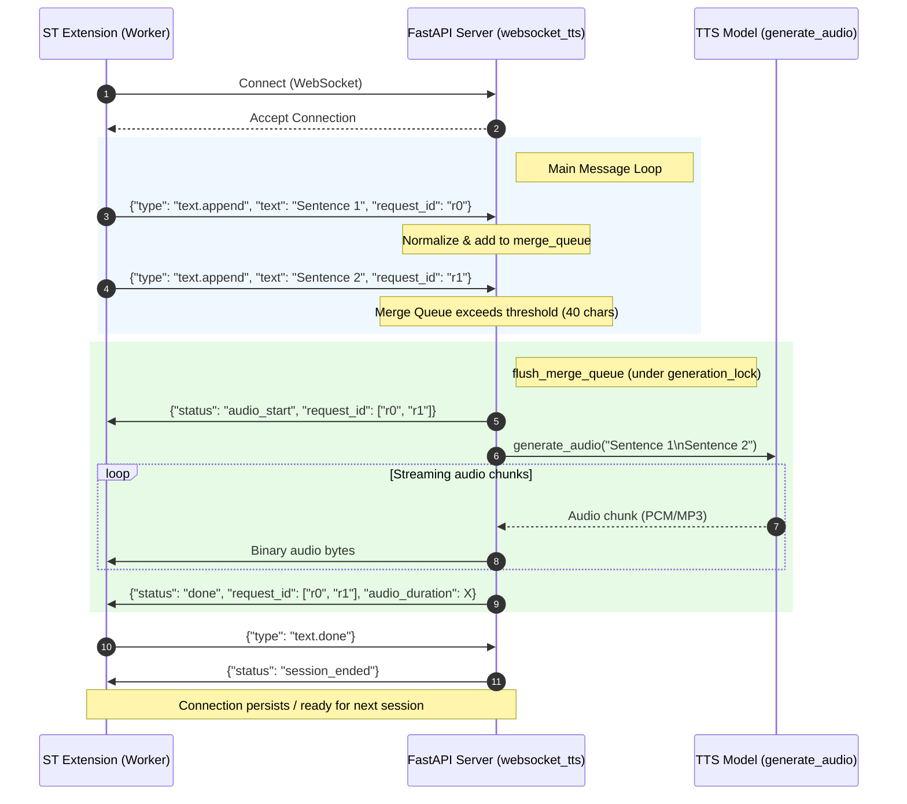
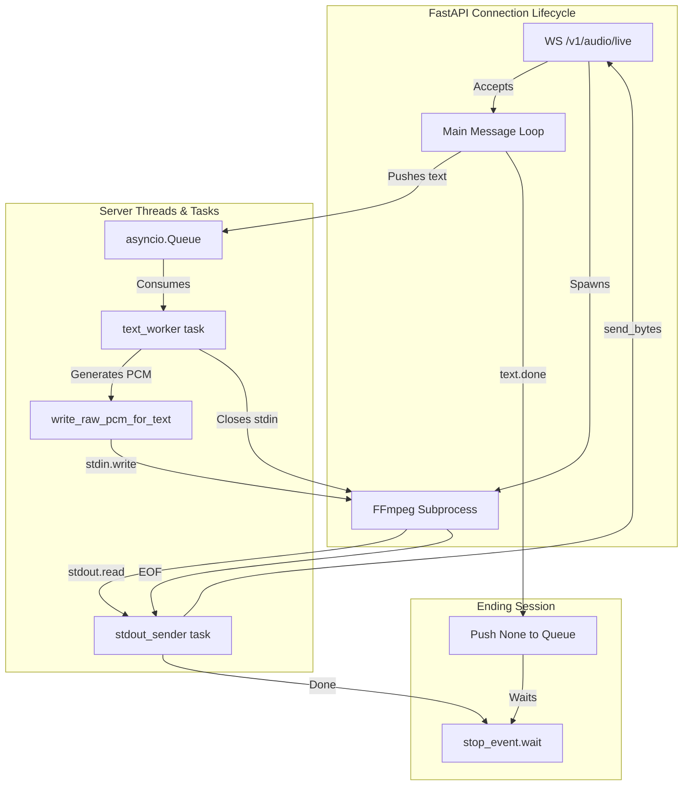

# PocketTTS WebSocket Server — Architecture & Workflows

This document details the step-by-step lifecycle and architecture of the Python backend server (`pocket-tts-openapi`) and how it handles WebSocket audio generation requests from the SillyTavern extension client.

Refer to the source files:
- Server API implementation: [api.py](file:///mnt/LLM/Media/pocket-tts-openapi/pocket_tts_server/api.py)
- Extension Client: [pocket-tts.ts](file:///mnt/LLM/Text/SillyTavern/data/default-user/extensions/SillyTavern-PocketTTS-WebSocket/src/pocket-tts.ts)
- Worker Thread: [ws-worker.ts](file:///mnt/LLM/Text/SillyTavern/data/default-user/extensions/SillyTavern-PocketTTS-WebSocket/src/ws-worker.ts)

---

## 📂 Server Endpoint Directory

The server defines several key API endpoints for standard and streaming audio generation:

| Endpoint | Protocol | Description |
|---|---|---|
| `/v1/models` | `GET` | Returns available voices and hardware devices. |
| `/v1/voices` | `GET` | Returns voices/speakers details. |
| `/v1/audio/speech` | `POST` | Standard non-streaming single-sentence TTS. |
| **`/v1/audio/stream`** | **`WS`** | **Buffered & Merged sentence-by-sentence WebSocket stream.** |
| **`/v1/audio/live`** | **`WS`** | **Persistent single-subprocess WebM/Opus streaming pipeline.** |
| `/v1/realtime` | `WS` | Low-latency bi-directional realtime voice channel. |

---

## ⚡ Mode 1: Sentence-Buffered Streaming (`/v1/audio/stream`)

This mode acts as a buffered queue. Sentences are merged dynamically based on length/rules to avoid choppy synthesis and reduce generation overhead.



### Detailed Step-by-Step Flow:

1. **Connection Establishment**:
   - The ST worker connects to `/v1/audio/stream`.
   - The server accepts the websocket connection (`websocket.accept()`) and checks if the model is loaded. If not, it sends an error and shuts down the connection.
2. **Buffer Initialization**:
   - The server initializes an empty list `merge_queue` along with locking primitives:
     - `merge_lock`: Prevents race conditions during enqueueing/grouping.
     - `generation_lock`: Ensures that binary frames and JSON responses for a given request are sent sequentially without overlapping with other generation tasks.
3. **Receiving Text (`text.append`)**:
   - When the client streams text, it sends a JSON payload: `{"type": "text.append", "text": "...", "request_id": "r0", "voice": "...", ...}`.
   - **Priority Retry**: If `retry: true` is provided, the server cancels active inactivity timers, immediately flushes any queued items, and synthesizes the retry sentence with high priority.
   - **Voice/Format Guardians**: If the target voice or audio format changes from the previous item in the queue, the existing queue is flushed immediately to prevent mixed configurations in a single audio segment.
   - **Merging Decision**: The normalized text is added to the `merge_queue`. The server flushes the queue if the total characters exceed a dynamic threshold:
     - **50 characters** if an odd number of double-quotes is found (helps preserve correct intonation in quoted speech).
     - **40 characters** (defined by `MIN_MERGE`) under standard conditions.
     - **5 items** maximum inside `merge_queue`.
   - **Inactivity Timeout**: If none of the thresholds are hit, a non-blocking timeout task (`inactivity_timeout()`) is started. It will trigger a flush if no new text arrives within an adaptive window (proportional to generation speed, usually ~15 seconds).
4. **Synthesis & Streaming**:
   - When the merge queue flushes, all items sharing the same settings are grouped together.
   - Under `generation_lock`, the merged text is passed to `generate_audio()`.
   - The server sends a JSON event: `{"status": "audio_start", "request_id": [ids]}`.
   - Audio chunks are continuously generated and sent as raw binary frames over the WebSocket.
   - Once generation is finished, a completion JSON message is sent: `{"status": "done", "request_id": [ids], "audio_duration": X, "gen_time": Y}`.
5. **Session End (`text.done`)**:
   - When the LLM finished streaming the message, the client sends `{"type": "text.done"}`.
   - The server cancels the inactivity timer and flushes any remaining items in the `merge_queue`.
   - Once all in-flight generation tasks reach zero, it transmits `{"status": "session_ended"}` to tell the client the session is complete.

---

## 🎛️ Mode 2: Persistent Live Subprocess Streaming (`/v1/audio/live`)

This mode establishes a persistent live media stream via a dedicated backend subprocess. Perfect for real-time speech where low-latency delivery is essential.



### Detailed Step-by-Step Flow:

1. **Subprocess Initialization**:
   - Upon connection, the server accepts the socket and spawns a persistent **FFmpeg** subprocess:
     ```bash
     ffmpeg -hide_banner -loglevel error \
            -f s16le -ar 24000 -ac 1 -i pipe:0 \
            -c:a libopus -b:a 192k \
            -f webm -live 1 -cluster_time_limit 100 pipe:1
     ```
   - Input (`pipe:0`): Raw Mono Signed 16-bit PCM at 24kHz.
   - Output (`pipe:1`): WebM container holding low-overhead libopus audio.
2. **Task Concurrency Launch**:
   - The server creates an `asyncio.Queue()` for texts and starts two background coroutines:
     - **`stdout_sender`**: Continuously reads encoded WebM data from `proc.stdout` in 8KB blocks and transmits them as raw WebSocket binary messages directly to the client.
     - **`text_worker`**: Polls the queue for sentences, generates raw PCM on-the-fly, and writes it directly into FFmpeg's `stdin`.
3. **Handling Incoming Text**:
   - The client streams sentences as standard `text.append` messages.
   - If it is the first sentence, the server immediately replies with the start signal:
     `{"status": "audio_start", "request_id": [first_id], "format": "webm", "live": true}`.
   - The text along with its synthesis parameters is pushed into the `text_queue`.
   - The `text_worker` processes the queue sequentially, calling `write_raw_pcm_for_text()` and flushing FFmpeg's stdin.
4. **Session Teardown & Finalization**:
   - When the client sends `{"type": "text.done"}`, the server exits the receive loop.
   - It pushes `None` to the `text_queue` to signal the `text_worker` to terminate.
   - The `text_worker` writes a 100ms silence tail (to prevent browser audio decoder truncation/clicks), closes FFmpeg's `stdin`, and sets the `stop_event` flag.
   - Once FFmpeg reads EOF, it finishes encoding, exits cleanly, and `stdout_sender` finishes.
   - The server transmits completion signals:
     `{"status": "done", "request_id": [...], "audio_duration": X, "live": true}` followed by `{"status": "session_ended"}`.
   - Finally, the server cleans up the background tasks and ensures the FFmpeg process is closed.

---

## 🛠️ Key Implementation Patterns

### 1. Sequential Audio Frame Association
Because binary WebSocket messages do not contain headers or JSON metadata, the client has no built-in way to know which request ID a set of audio frames belongs to. The server solves this elegantly:
- **Strict Serialization**: By utilizing `generation_lock` (in stream mode) and `asyncio.Queue` (in live mode), audio generations are executed sequentially.
- **Ordered JSON Metadata**: The server guarantees that the binary chunks sent between a `status: "audio_start"` JSON event and a `status: "done"` JSON event correspond exactly to the `request_id` array announced in the start/done JSON frames.

### 2. Quotation-Sensitive Sentence Merging
Synthesizing sentences individually can sound robotic. However, holding too much text in the buffer degrades responsiveness. The server dynamically calculates the optimal synthesis length based on the character length of the buffer, but decreases this threshold when an odd count of double quotes exists. This prevents the model from splitting a quote in half, which would ruin the speaker's emotional intonation.

### 3. Adaptive Inactivity Flushes
If the server's hardware is generating audio slowly, the inactivity timeout is automatically stretched using:
`timeout = 15.0 * max(0.5, min(2.0, gen_speed))`
This ensures slower systems do not prematurely fragment the audio stream while faster systems get low-latency updates.
